## Generalidades
Codigo de partida: 4 caracteres alfanumericos, case-insensitive.
Se utilizo java 21 con Maven, Jackson, jsvg y JUnit5

Estudiantes: Andres Madrigal y David Zuniga


## Spec Cliente
 
```
src/
|-- main/
    |-- Main.java
|-- client/
    |-- constantes/
        |-- Constants.java
        |-- UIConstants.java
        |-- NetworkConstants.java
    |-- red/
        |-- ServerConnection.java
        |-- MessageDispatcher.java
    |-- mensajes/
        |-- TipoMensaje.java
        |-- Mensaje.java
        |-- MensajeJugador.java
        |-- MensajeServidor.java
        |-- MensajeIndicarNombre.java
        |-- MensajeCreateMatch.java
        |-- MensajeJoinMatch.java
        |-- MensajeSelectAnimal.java
        |-- MensajeMoveAnimals.java
        |-- MensajeAttack.java
        |-- MensajeViewZone.java
        |-- MensajePrimerMensaje.java
        |-- MensajeMatchCreated.java
        |-- MensajeMatchJoined.java
        |-- MensajeAnimalSelection.java
        |-- MensajeGameStarted.java
        |-- MensajeStateUpdate.java
        |-- MensajeGameOver.java
        |-- MensajeError.java
    |-- modelo/
        |-- GameModel.java
        |-- AccionDeMensaje.java
        |-- AccionMensaje.java
        |-- AccionMatchCreated.java
        |-- AccionMatchJoined.java
        |-- AccionAnimalSelection.java
        |-- AccionGameStarted.java
        |-- AccionGameOver.java
        |-- AccionError.java
        |-- DatosEnviar.java
        |-- Jugador.java
        |-- Entidad.java
        |-- TipoEntidad.java
        |-- Animal.java
        |-- Cafe.java
        |-- Bandera.java
        |-- Evento.java
        |-- TipoEvento.java
        |-- Zona.java
        |-- Nodo.java
        |-- Posicion.java
        |-- Punto.java
        |-- TipoEspecie.java
    |-- controlador/
        |-- SelectionManager.java
        |-- GameController.java
    |-- vista/
        |-- MainWindow.java
        |-- GamePanel.java
        |-- HUDPanel.java
    |-- util/
        |-- Observer.java
        |-- Observable.java
        |-- ImageCache.java
        |-- Json.java
|-- test/
    |-- JsonTest.java
    |-- MessageDispatcherTest.java
    |-- GameModelTest.java
    |-- SelectionManagerTest.java
```
 
### main
#### Main
+ main(args : String[]) : static void

Punto de entrada de la aplicación: inicializa `GameModel`, `MessageDispatcher` y `GameController`, y muestra `MainWindow` en el hilo de eventos de Swing. Al cerrar la ventana, desconecta la conexión activa.

### constantes

#### Constants (Clase final)
+ SERVER_IP : static final String
+ SERVER_PORT : static final int
+ LONGITUD_CODIGO : static final int
+ NOMBRE_UNIVERSAL : static final String
+ MAX_PLAYER_ENERGY : static final int
+ PLAYER_PACK_SIZE : static final int
+ TOTAL_ZONES : static final int
+ TOTAL_COFFEE_CUPS : static final int
+ ENCOUNTER_RADIUS : static final double
- Constants()

// Parámetros de conexión y copia de las constantes del servidor que el cliente necesita para dibujar y validar.
// SERVER_IP = "localhost". SERVER_PORT debe ser igual a ServerConfig.getPuerto() del servidor.
// NOMBRE_UNIVERSAL = "@Todos": el cliente no puede usarlo como nickname.
// LONGITUD_CODIGO = 4. Los valores numéricos deben coincidir con Constantes del servidor.

#### UIConstants (Clase final)
+ WINDOW_WIDTH : static final int
+ WINDOW_HEIGHT : static final int
+ FPS : static final int
+ ANIMAL_SIZE_PX : static final int
+ HIT_RADIUS_PX : static final int
+ MARGEN_MAPA_PX : static final int
+ DURACION_EVENTO_MS : static final long
- UIConstants()

// Dimensiones de la ventana y valores de renderizado. FPS = tasa de refresco de GamePanel.
// HIT_RADIUS_PX: distancia máxima del clic a un animal o nodo para considerarlo "clicado".
// DURACION_EVENTO_MS: cuánto tiempo se dibuja la línea de un evento ATAQUE.

#### NetworkConstants (Clase final)
+ DEFAULT_PORT : static final int
+ DEFAULT_HOST : static final String
- NetworkConstants()

// Valores predeterminados de la caja de diálogo de conexión. DEFAULT_PORT = Constants.SERVER_PORT y DEFAULT_HOST = Constants.SERVER_IP.

### red

#### ServerConnection (implements Runnable)
- socket : Socket
- entrada : BufferedReader
- salida : PrintWriter
- modelo : GameModel 
- activo : boolean
+ ServerConnection(host : String, puerto : int, dispatcher : MessageDispatcher)
+ run() : void
+ enviar (msg : Mensaje) : void
+ recibirAscender (msg : Mensaje) : void
+ isActivo() : boolean
+ desconectar() : void

### modelo


#### AccionDeMensaje
+ static obtenerAccion(msg : Mensaje) : AccionMensaje

//Strategy
#### AccionMensaje 
- mensaje : Mensaje
+ ejecutar(model : GameModel) : void

#### AccionMatchCreated (extends AccionMensaje)
+ ejecutar(model : GameModel) : void

#### AccionMatchJoined (extends AccionMensaje)
+ ejecutar(model : GameModel) : void

#### AccionAnimalSelection (extends AccionMensaje)
+ ejecutar(model : GameModel) : void

#### AccionGameStarted (extends AccionMensaje)
+ ejecutar(model : GameModel) : void

#### AccionGameOver (extends AccionMensaje)
+ ejecutar(model : GameModel) : void

#### AccionError (extends AccionMensaje)
+ ejecutar(model : GameModel) : void

#### GameModel (extends Observable)
- nickname : String
- codigoPartida : String
- nombreConfirmado : boolean
- jugadoresEnPartida : List\<String>
- especiesDisponibles : List\<TipoEspecie>
- seleccionOponente : TipoEspecie
- zonaActualVisible : int
- datos : DatosEnviar
- animalesLocales : List\<Animal>
- animalesConocidos : Map\<String, Animal>
- listaObservers : List\<Observer>
- ganador : String
- ultimoError : String
+ GameModel()
+ agregarObserver (o : Observer) : void
+ setNickname(nickname : String) : void
+ getNickname() : String
+ getCodigoPartida() : String
+ isNombreConfirmado() : boolean
+ getJugadoresEnPartida() : List\<String>
+ getEspeciesDisponibles() : List\<TipoEspecie>
+ getSeleccionOponente() : TipoEspecie
+ getDatos() : DatosEnviar
+ getJugadorLocal() : Jugador
+ getOponente() : Jugador
+ getAnimalesLocales() : List\<Animal>
+ getEnergiaConocida(idPack : int) : int
+ getVivosConocidos(idPack : int) : int
+ getGanador() : String
+ getUltimoError() : String
+ getZonaActualVisible() : int
+ setZonaActualVisible(zonaId : int) : void
+ actualizarEstado(datos : DatosEnviar) : void
+ realizarAccion (accion : AccionMensaje) : void
+ onDesconexion() : void
+ reiniciarPartida() : void
- notificar(tipo : TipoMensaje) : void
- recordarAnimales(datos : DatosEnviar) : void

// Estado del juego en el cliente
// El argumento de notifyObservers es el TipoMensaje que originó el cambio, así las vistas saben qué cambió.
// reiniciarPartida() se ejecuta despues de que la partida termine

#### DatosEnviar
- jugadorA : Jugador
- jugadorB : Jugador
- entidadesDisponibles : List\<Entidad>
- zonaActual : Zona
- eventos : List\<Evento>
- DatosEnviar()
+ getJugadorA() : Jugador
+ getJugadorB() : Jugador
+ getEntidadesDisponibles() : List\<Entidad>
+ getZonaActual() : Zona
+ getEventos() : List\<Evento>
+ getAnimalesVisibles() : List\<Animal>

#### Jugador
- id : int
- nickname : String
- especie : TipoEspecie
- animales : List\<Animal>
- cafesConsumidos : int
- botsEliminados : int
- conectado : boolean
- Jugador()
+ getId() : int
+ getNickname() : String
+ getEspecie() : TipoEspecie
+ getAnimales() : List\<Animal>
+ getCafesConsumidos() : int
+ getBotsEliminados() : int
+ isConectado() : boolean
+ getVivos() : int
+ getEnergiaTotal() : int

#### TipoEntidad (enum)
+ ANIMAL
+ CAFE
+ BANDERA

#### Entidad (abstract)
- id : int
- tipo : TipoEntidad
- posicion : Posicion
+ Entidad()
+ getId() : int
+ getTipo() : TipoEntidad
+ getPosicion() : Posicion


#### Animal (extends Entidad)
- idPack : int
- especie : TipoEspecie
- energia : int
+ Animal()
+ getIdPack() : int
+ getEspecie() : TipoEspecie
+ getEnergia() : int
+ estaVivo() : boolean
+ getX() : double
+ getY() : double
+ getIdCompuesto() : int[]

#### Cafe (extends Entidad)
- consumido : boolean
+ Cafe()
+ isConsumido() : boolean
+ estaDisponible() : boolean

#### Bandera (extends Entidad)
- idJugador : int
- color : String
+ Bandera()
+ getIdJugador() : int
+ getColor() : String

#### TipoEvento (enum)
+ ATAQUE

#### Evento
- tipo : TipoEvento
- origen : Posicion
- destino : Posicion
+ Evento()
+ getTipo() : TipoEvento
+ getOrigen() : Posicion
+ getDestino() : Posicion

#### Zona
- id : int
- nodos : List\<Nodo>
+  Zona()
+ getId() : int
+ getNodos() : List\<Nodo>
+ getNodo(idNodo : int) : Nodo

#### Nodo
- id : int
- posicion : Punto
- idZona : int
+ Nodo()
+ getId() : int
+ getPosicion() : Punto
+ getIdZona() : int

#### Posicion
- nodo : Nodo
- punto : Punto
+ Posicion()
+ getNodo() : Nodo
+ getPunto() : Punto

#### Punto
- x : double
- y : double
+ Punto()
+ Punto(x : double, y : double) : Punto
+ getX() : double
+ getY() : double

#### TipoEspecie (enum)
+ JAGUAR
+ YIGUIRRO
+ PEREZOSO
+ DANTA
+ TUCAN
+ VENADO_CO_BLA
+ MONO_CO_BLA
+ NINGUNA

### controlador

#### SelectionManager
- animalesSeleccionados : List\<Animal>
+ SelectionManager()
+ seleccionar(animal : Animal) : void
+ deseleccionar(animal : Animal) : void
+ deseleccionarTodo() : void
+ estaSeleccionado(animal : Animal) : boolean
+ getSeleccionados() : List\<Animal>
+ getIdsSeleccionados() : List\<int[]>
+ sincronizar(vigentes : List\<Animal>) : void

// Controla la selección de animales por clic del usuario.
// getIdsSeleccionados() devuelve los int[]{idPack, idAnimal} listos para MensajeMoveAnimals.
// Solo se pueden seleccionar animales vivos del jugador local.

#### GameController
- model : GameModel
- dispatcher : MessageDispatcher
- conexion : ServerConnection
- hiloConexion : Thread
- seleccion : SelectionManager
+ GameController(model : GameModel, dispatcher : MessageDispatcher)
+ conectar(host : String, puerto : int, nickname : String) : boolean
+ desconectar() : void
+ crearPartida() : void
+ unirsePartida(codigo : String) : void
+ seleccionarEspecie(especie : TipoEspecie) : void
+ moverSeleccion(idNodoDestino : int) : void
+ atacar(enemigo : Animal) : void
+ verZona(idZona : int) : void
+ getSeleccion() : SelectionManager
+ getModel() : GameModel
- enviar(msg : MensajeJugador) : void
- nombreValido(nickname : String) : boolean
- codigoValido(codigo : String) : boolean

### vista

#### MainWindow (extends JFrame, implements Observer)
- controlador : GameController
- model : GameModel
- gamePanel : GamePanel
- hudPanel : HUDPanel
- layout : CardLayout
- contenedor : JPanel
+ MainWindow(controlador : GameController)
+ mostrarPantalla(panelName : String) : void
+ update(tipo : TipoMensaje) : void
+ static main(args : String[]) : void
- pedirConexion() : void
- mostrarMenuPrincipal() : void
- mostrarSeleccionEspecie() : void
- mostrarMensaje(texto : String) : void

#### GamePanel (extends JPanel, implements MouseListener)
- model : GameModel
- controlador : GameController
- timer : javax.swing.Timer
- limites : Rectangle2D.Double
- eventosActivos : Map\<Evento, Long>
- ultimoDatos : Datos
+ GamePanel(model : GameModel, controlador : GameController)
+ paintComponent(g : Graphics) : void
+ mousePressed(e : MouseEvent) : void
- calcularLimites() : void
- registrarEventosNuevos() : void
- mundoAPantalla(p : Punto) : Point2D
- pantallaAMundo(x : int, y : int) : Punto
- animalEn(x : int, y : int) : Animal
- nodoEn(x : int, y : int) : Nodo
- dibujarZona(g : Graphics2D) : void
- dibujarEntidades(g : Graphics2D) : void
- dibujarEventos(g : Graphics2D) : void

#### HUDPanel (extends JPanel, implements Observer)
- model : GameModel
- controlador : GameController
- barraVidaLocal : JProgressBar
- barraVidaOponente : JProgressBar
- etiquetaCafes : JLabel
- etiquetaCodigo : JLabel
- etiquetaZona : JLabel
- botonesZona : List\<JButton>
+ HUDPanel(model : GameModel, controlador : GameController)
+ update(tipo : TipoMensaje) : void
- construirUI() : void
- refrescar() : void

// Muestra estadísticas: barra de energía local (máximo Constants.MAX_PLAYER_ENERGY * Constants.PLAYER_PACK_SIZE) y del oponente,
// tazas de café (cafesConsumidos / Constants.TOTAL_COFFEE_CUPS), código de la partida y zona visible.
// botonesZona: uno por zona (Constants.TOTAL_ZONES). Al pulsar uno se llama controlador.verZona(idZona).


### util

#### Observer
+ update(tipo : TipoMensaje) : void
#### Observable
+ agregarObserver (o : Observer) : void
+ notificar (tipo : TipoMensaje) : void

#### ImageCache (Patrón Singleton)
- instancia : static ImageCache
- imagenes : Map\<String, BufferedImage>
- ImageCache()
+ static getInstance() : ImageCache
+ precargar() : void
+ getImagen(key : String) : BufferedImage

// Caché global de imágenes y texturas para no leer disco repetidamente.

#### Json
+ mensajeAJson(msg : Mensaje) : Static String
+ jsonAMensaje(json : String) : Static Mensaje

### mensajes

#### TipoMensaje (enum)
+ PRIMER_MENSAJE
+ INDICAR_NOMBRE
+ CREATE_MATCH
+ JOIN_MATCH
+ SELECT_ANIMAL
+ MOVE_ANIMALS
+ ATTACK
+ VIEW_ZONE
+ MATCH_CREATED
+ MATCH_JOINED
+ ANIMAL_SELECTION
+ GAME_STARTED
+ STATE_UPDATE
+ GAME_OVER
+ ERROR

#### Mensaje (abstract)
- tipo : TipoMensaje
+ Mensaje(tipo : TipoMensaje, nombre : String)
+ getTipo() : TipoMensaje

// Clase base de todos los mensajes.

#### MensajeJugador (abstract, extends Mensaje)
- nombre : String
+ MensajeJugador(tipo : TipoMensaje, nombre : String)
+ getNombre() : String
+ setNombre(nombre : String) : void
// Agrupa todos los mensajes cliente -> servidor..

#### MensajeServidor (abstract, extends Mensaje)
+ MensajeServidor(tipo : TipoMensaje)

// Agrupa todos los mensajes servidor -> cliente.


//Cliente -> Servidor 

#### MensajeIndicarNombre (extends MensajeJugador)
+ MensajeIndicarNombre(nombre : String)

// tipo = INDICAR_NOMBRE
// Solo usa el nombre heredado.

#### MensajeCreateMatch (extends MensajeJugador)
+ MensajeCreateMatch(nombre : String)

// tipo = CREATE_MATCH
// Sin payload.

#### MensajeJoinMatch (extends MensajeJugador)
- codigo : String
+ MensajeJoinMatch(nombre : String, codigo : String)
+ getCodigo() : String

// tipo = JOIN_MATCH

#### MensajeSelectAnimal (extends MensajeJugador)
- especie : TipoEspecie
+ MensajeSelectAnimal(nombre : String, especie : TipoEspecie)
+ getEspecie() : TipoEspecie

// tipo = SELECT_ANIMAL

#### MensajeMoveAnimals (extends MensajeJugador)
- animales : List\<int[]>
- idNodoDestino : int
+ MensajeMoveAnimals(nombre : String, animales : List\<int[]>, idNodoDestino : int)
+ getAnimales() : List\<int[]>
+ getIdNodoDestino() : int

// tipo = MOVE_ANIMALS
// Cada animal se identifica como int[]{idPack, idAnimal}.
// El servidor calcula la ruta con Mapa.getRuta().

#### MensajeAttack (extends MensajeJugador)
- atacante : int[]
- enemigo : int[]
+ MensajeAttack(nombre : String, atacante : int[], enemigo : int[])
+ getAtacante() : int[]
+ getEnemigo() : int[]

// tipo = ATTACK
// Mismo formato que Partida.mandarAtaque(A, B): int[]{idPack, idAnimal}.

#### MensajeViewZone (extends MensajeJugador)
- idZona : int
+ MensajeViewZone(nombre : String, idZona : int)
+ getIdZona() : int

// tipo = VIEW_ZONE


//Servidor -> Cliente 

#### MensajePrimerMensaje (extends MensajeServidor)
- exito : boolean
- razon : String
+ MensajePrimerMensaje(exito : boolean, razon : String)
+ isExito() : boolean
+ getRazon() : String

// tipo = PRIMER_MENSAJE
// razon indica por qué se rechazó la conexión (null si exito es true).

#### MensajeMatchCreated (extends MensajeServidor)
- codigo : String
+ MensajeMatchCreated(codigo : String)
+ getCodigo() : String

// tipo = MATCH_CREATED

#### MensajeMatchJoined (extends MensajeServidor)
- codigo : String
- jugadores : List\<String>
+ MensajeMatchJoined(¿codigo : String, jugadores : List\<String>)
+ getCodigo() : String
+ getJugadores() : List\<String>

// tipo = MATCH_JOINED

#### MensajeAnimalSelection (extends MensajeServidor)
- especiesDisponibles : List\<TipoEspecie>
- seleccionOponente : TipoEspecie
+ MensajeAnimalSelection(especiesDisponibles : List\<TipoEspecie>), especieE : TipoEspecie) 
+ getEspeciesDisponibles() : List\<TipoEspecie>
+ getSeleccionOponente() : TipoEspecie

// tipo = ANIMAL_SELECTION

#### MensajeGameStarted (extends MensajeServidor)
- datos : DatosEnviar
+ MensajeGameStarted(datos : DatosEnviar)
+ getDatos() : Datos

// tipo = GAME_STARTED
// datos = estado inicial visible para ese jugador.

#### MensajeStateUpdate (extends MensajeServidor)
- datos : DatosEnviar
+ MensajeStateUpdate(datos : DatosEnviar)
+ getDatos() : Datos

// tipo = STATE_UPDATE
// datos = estado actual visible para ese jugador.

#### MensajeGameOver (extends MensajeServidor)
- ganador : String
+ MensajeGameOver(ganador : String)
+ getGanador() : String

// tipo = GAME_OVER

#### MensajeError (extends MensajeServidor)
- descripcion : String
+ MensajeError(descripcion : String)
+ getDescripcion() : String

// tipo = ERROR
// Solo se usa si el cliente puede hacer algo al respecto; las desconexiones se manejan con excepciones del socket.

### Test

#### JsonTest
+ mensajeAJsonEnvuelveEnTypeYPayloadEnUnaSolaLinea() : void
+ jsonAMensajeTypeDesconocidoLanzaIllegalArgumentException() : void
+ jsonAMensajePayloadNoEncajaLanzaIllegalArgumentException() : void
+ roundTripTodosLosTiposDeMensaje() : void
+ deserializarEntidadAnimalCafeBanderaResuelveSubtipoPorTipo() : void
+ deserializarPosicionConNodoNullNoFalla() : void

#### MessageDispatcherTest
+ despacharMatchCreatedInvocaOnMatchCreated() : void
+ despacharGameStartedInvocaOnGameStarted() : void
+ despacharStateUpdateInvocaActualizarEstado() : void
+ despacharGameOverInvocaOnGameOver() : void
+ despacharJsonInvalidoNoLanzaExcepcionNiTocaElModelo() : void
+ despacharMensajeClienteAServidorSeDescarta() : void
+ conexionPerdidaInvocaOnDesconexion() : void

#### GameModelTest
+ onPrimerMensajeExitoTrueNombreConfirmado() : void
+ onPrimerMensajeExitoFalseGuardaRazonComoUltimoError() : void
+ onMatchJoinedGuardaCodigoYJugadores() : void
+ onGameStartedGuardaDatosYZonaVisibleInicial() : void
+ actualizarEstadoRecuerdaAnimalesConocidos() : void
+ getJugadorLocalIdentificaPorNickname() : void
+ reiniciarPartidaLimpiaElEstadoPeroConservaNickname() : void
+ cadaCambioNotificaObservadoresConElTipoMensajeCorrecto() : void
- validarEstadoVisibleZona(int idZona) : boolean

#### SelectionManagerTest
+ seleccionarAnimalVivoLocalSeAgrega() : void
+ seleccionarAnimalMuertoSeRechaza() : void
+ seleccionarAnimalDeOtroJugadorSeRechaza() : void
+ seleccionarDosVecesNoDuplica() : void
+ getIdsSeleccionadosDevuelveIdPackEIdAnimal() : void
+ sincronizarQuitaAnimalesQueYaNoEstanVivosONiVigentes() : void
- isAnimalSeleccionable(Animal animal) : boolean

## Diagrama

```mermaid
classDiagram
    direction TB

    %% ===================== MAIN =====================
    class Main {
        +main(String[] args)$ void
    }

    %% ===================== CONSTANTES =====================
    class Constants {
        <<final>>
        +String SERVER_IP$
        +int SERVER_PORT$
        +int LONGITUD_CODIGO$
        +String NOMBRE_UNIVERSAL$
        +int MAX_PLAYER_ENERGY$
        +int PLAYER_PACK_SIZE$
        +int TOTAL_ZONES$
        +int TOTAL_COFFEE_CUPS$
        +double ENCOUNTER_RADIUS$
        -Constants()
    }
    class UIConstants {
        <<final>>
        +int WINDOW_WIDTH$
        +int WINDOW_HEIGHT$
        +int FPS$
        +int ANIMAL_SIZE_PX$
        +int HIT_RADIUS_PX$
        +int MARGEN_MAPA_PX$
        +long DURACION_EVENTO_MS$
        -UIConstants()
    }
    class NetworkConstants {
        <<final>>
        +int DEFAULT_PORT$
        +String DEFAULT_HOST$
        -NetworkConstants()
    }

    %% ===================== RED =====================
    class ServerConnection {
        -Socket socket
        -BufferedReader entrada
        -PrintWriter salida
        -GameModel modelo
        -boolean activo
        +ServerConnection(String host, int puerto, MessageDispatcher dispatcher)
        +run() void
        +enviar(Mensaje msg) void
        +recibirAscender(Mensaje msg) void
        +isActivo() boolean
        +desconectar() void
    }
    class MessageDispatcher {
        -GameModel model
        +MessageDispatcher(GameModel model)
        +despachar(String json) void
        +conexionPerdida() void
    }

    %% ===================== MODELO =====================
    class AccionDeMensaje {
        +obtenerAccion(Mensaje msg)$ AccionMensaje
    }
    class AccionMensaje {
        <<abstract>>
        -Mensaje mensaje
        +ejecutar(GameModel model) void
    }
    class AccionMatchCreated {
        +ejecutar(GameModel model) void
    }
    class AccionMatchJoined {
        +ejecutar(GameModel model) void
    }
    class AccionAnimalSelection {
        +ejecutar(GameModel model) void
    }
    class AccionGameStarted {
        +ejecutar(GameModel model) void
    }
    class AccionGameOver {
        +ejecutar(GameModel model) void
    }
    class AccionError {
        +ejecutar(GameModel model) void
    }
    class GameModel {
        -String nickname
        -String codigoPartida
        -boolean nombreConfirmado
        -List~String~ jugadoresEnPartida
        -List~TipoEspecie~ especiesDisponibles
        -TipoEspecie seleccionOponente
        -int zonaActualVisible
        -DatosEnviar datos
        -List~Animal~ animalesLocales
        -Map~String, Animal~ animalesConocidos
        -List~Observer~ listaObservers
        -String ganador
        -String ultimoError
        +GameModel()
        +agregarObserver(Observer o) void
        +setNickname(String nickname) void
        +getNickname() String
        +getCodigoPartida() String
        +isNombreConfirmado() boolean
        +getJugadoresEnPartida() List~String~
        +getEspeciesDisponibles() List~TipoEspecie~
        +getSeleccionOponente() TipoEspecie
        +getDatos() DatosEnviar
        +getJugadorLocal() Jugador
        +getOponente() Jugador
        +getAnimalesLocales() List~Animal~
        +getEnergiaConocida(int idPack) int
        +getVivosConocidos(int idPack) int
        +getGanador() String
        +getUltimoError() String
        +getZonaActualVisible() int
        +setZonaActualVisible(int zonaId) void
        +actualizarEstado(DatosEnviar datos) void
        +realizarAccion(AccionMensaje accion) void
        +onDesconexion() void
        +reiniciarPartida() void
        -notificar(TipoMensaje tipo) void
        -recordarAnimales(DatosEnviar datos) void
    }
    class DatosEnviar {
        -Jugador jugadorA
        -Jugador jugadorB
        -List~Entidad~ entidadesDisponibles
        -Zona zonaActual
        -List~Evento~ eventos
        -DatosEnviar()
        +getJugadorA() Jugador
        +getJugadorB() Jugador
        +getEntidadesDisponibles() List~Entidad~
        +getZonaActual() Zona
        +getEventos() List~Evento~
        +getAnimalesVisibles() List~Animal~
    }
    class Jugador {
        -int id
        -String nickname
        -TipoEspecie especie
        -List~Animal~ animales
        -int cafesConsumidos
        -int botsEliminados
        -boolean conectado
        -Jugador()
        +getId() int
        +getNickname() String
        +getEspecie() TipoEspecie
        +getAnimales() List~Animal~
        +getCafesConsumidos() int
        +getBotsEliminados() int
        +isConectado() boolean
        +getVivos() int
        +getEnergiaTotal() int
    }
    class TipoEntidad {
        <<enumeration>>
        ANIMAL
        CAFE
        BANDERA
    }
    class Entidad {
        <<abstract>>
        -int id
        -TipoEntidad tipo
        -Posicion posicion
        +Entidad()
        +getId() int
        +getTipo() TipoEntidad
        +getPosicion() Posicion
    }
    class Animal {
        -int idPack
        -TipoEspecie especie
        -int energia
        +Animal()
        +getIdPack() int
        +getEspecie() TipoEspecie
        +getEnergia() int
        +estaVivo() boolean
        +getX() double
        +getY() double
        +getIdCompuesto() int[]
    }
    class Cafe {
        -boolean consumido
        +Cafe()
        +isConsumido() boolean
        +estaDisponible() boolean
    }
    class Bandera {
        -int idJugador
        -String color
        +Bandera()
        +getIdJugador() int
        +getColor() String
    }
    class TipoEvento {
        <<enumeration>>
        ATAQUE
    }
    class Evento {
        -TipoEvento tipo
        -Posicion origen
        -Posicion destino
        +Evento()
        +getTipo() TipoEvento
        +getOrigen() Posicion
        +getDestino() Posicion
    }
    class Zona {
        -int id
        -List~Nodo~ nodos
        +Zona()
        +getId() int
        +getNodos() List~Nodo~
        +getNodo(int idNodo) Nodo
    }
    class Nodo {
        -int id
        -Punto posicion
        -int idZona
        +Nodo()
        +getId() int
        +getPosicion() Punto
        +getIdZona() int
    }
    class Posicion {
        -Nodo nodo
        -Punto punto
        +Posicion()
        +getNodo() Nodo
        +getPunto() Punto
    }
    class Punto {
        -double x
        -double y
        +Punto()
        +Punto(double x, double y)
        +getX() double
        +getY() double
    }
    class TipoEspecie {
        <<enumeration>>
        JAGUAR
        YIGUIRRO
        PEREZOSO
        DANTA
        TUCAN
        VENADO_CO_BLA
        MONO_CO_BLA
        NINGUNA
    }

    %% ===================== CONTROLADOR =====================
    class SelectionManager {
        -List~Animal~ animalesSeleccionados
        +SelectionManager()
        +seleccionar(Animal animal) void
        +deseleccionar(Animal animal) void
        +deseleccionarTodo() void
        +estaSeleccionado(Animal animal) boolean
        +getSeleccionados() List~Animal~
        +getIdsSeleccionados() List~int[]~
        +sincronizar(List~Animal~ vigentes) void
    }
    class GameController {
        -GameModel model
        -MessageDispatcher dispatcher
        -ServerConnection conexion
        -Thread hiloConexion
        -SelectionManager seleccion
        +GameController(GameModel model, MessageDispatcher dispatcher)
        +conectar(String host, int puerto, String nickname) boolean
        +desconectar() void
        +crearPartida() void
        +unirsePartida(String codigo) void
        +seleccionarEspecie(TipoEspecie especie) void
        +moverSeleccion(int idNodoDestino) void
        +atacar(Animal enemigo) void
        +verZona(int idZona) void
        +getSeleccion() SelectionManager
        +getModel() GameModel
        -enviar(MensajeJugador msg) void
        -nombreValido(String nickname) boolean
        -codigoValido(String codigo) boolean
    }

    %% ===================== VISTA =====================
    class MainWindow {
        -GameController controlador
        -GameModel model
        -GamePanel gamePanel
        -HUDPanel hudPanel
        -CardLayout layout
        -JPanel contenedor
        +MainWindow(GameController controlador)
        +mostrarPantalla(String panelName) void
        +update(TipoMensaje tipo) void
        +main(String[] args)$ void
        -pedirConexion() void
        -mostrarMenuPrincipal() void
        -mostrarSeleccionEspecie() void
        -mostrarMensaje(String texto) void
    }
    class GamePanel {
        -GameModel model
        -GameController controlador
        -Timer timer
        -Rectangle2D.Double limites
        -Map~Evento, Long~ eventosActivos
        -DatosEnviar ultimoDatos
        +GamePanel(GameModel model, GameController controlador)
        +paintComponent(Graphics g) void
        +mousePressed(MouseEvent e) void
        -calcularLimites() void
        -registrarEventosNuevos() void
        -mundoAPantalla(Punto p) Point2D
        -pantallaAMundo(int x, int y) Punto
        -animalEn(int x, int y) Animal
        -nodoEn(int x, int y) Nodo
        -dibujarZona(Graphics2D g) void
        -dibujarEntidades(Graphics2D g) void
        -dibujarEventos(Graphics2D g) void
    }
    class HUDPanel {
        -GameModel model
        -GameController controlador
        -JProgressBar barraVidaLocal
        -JProgressBar barraVidaOponente
        -JLabel etiquetaCafes
        -JLabel etiquetaCodigo
        -JLabel etiquetaZona
        -List~JButton~ botonesZona
        +HUDPanel(GameModel model, GameController controlador)
        +update(TipoMensaje tipo) void
        -construirUI() void
        -refrescar() void
    }

    %% ===================== UTIL =====================
    class Observer {
        <<interface>>
        +update(TipoMensaje tipo) void
    }
    class Observable {
        <<abstract>>
        +agregarObserver(Observer o) void
        +notificar(TipoMensaje tipo) void
    }
    class ImageCache {
        <<singleton>>
        -ImageCache instancia$
        -Map~String, BufferedImage~ imagenes
        -ImageCache()
        +getInstance()$ ImageCache
        +precargar() void
        +getImagen(String key) BufferedImage
    }
    class Json {
        +mensajeAJson(Mensaje msg)$ String
        +jsonAMensaje(String json)$ Mensaje
    }

    %% ===================== MENSAJES =====================
    class TipoMensaje {
        <<enumeration>>
        PRIMER_MENSAJE
        INDICAR_NOMBRE
        CREATE_MATCH
        JOIN_MATCH
        SELECT_ANIMAL
        MOVE_ANIMALS
        ATTACK
        VIEW_ZONE
        MATCH_CREATED
        MATCH_JOINED
        ANIMAL_SELECTION
        GAME_STARTED
        STATE_UPDATE
        GAME_OVER
        ERROR
    }
    class Mensaje {
        <<abstract>>
        -TipoMensaje tipo
        +getTipo() TipoMensaje
    }
    class MensajeJugador {
        <<abstract>>
        -String nombre
        +getNombre() String
        +setNombre(String nombre) void
    }
    class MensajeServidor {
        <<abstract>>
    }
    class MensajeIndicarNombre
    class MensajeCreateMatch
    class MensajeJoinMatch {
        -String codigo
        +getCodigo() String
    }
    class MensajeSelectAnimal {
        -TipoEspecie especie
        +getEspecie() TipoEspecie
    }
    class MensajeMoveAnimals {
        -List~int[]~ animales
        -int idNodoDestino
        +getAnimales() List~int[]~
        +getIdNodoDestino() int
    }
    class MensajeAttack {
        -int[] atacante
        -int[] enemigo
        +getAtacante() int[]
        +getEnemigo() int[]
    }
    class MensajeViewZone {
        -int idZona
        +getIdZona() int
    }
    class MensajePrimerMensaje {
        -boolean exito
        -String razon
        +isExito() boolean
        +getRazon() String
    }
    class MensajeMatchCreated {
        -String codigo
        +getCodigo() String
    }
    class MensajeMatchJoined {
        -String codigo
        -List~String~ jugadores
        +getCodigo() String
        +getJugadores() List~String~
    }
    class MensajeAnimalSelection {
        -List~TipoEspecie~ especiesDisponibles
        -TipoEspecie seleccionOponente
        +getEspeciesDisponibles() List~TipoEspecie~
        +getSeleccionOponente() TipoEspecie
    }
    class MensajeGameStarted {
        -DatosEnviar datos
        +getDatos() DatosEnviar
    }
    class MensajeStateUpdate {
        -DatosEnviar datos
        +getDatos() DatosEnviar
    }
    class MensajeGameOver {
        -String ganador
        +getGanador() String
    }
    class MensajeError {
        -String descripcion
        +getDescripcion() String
    }

    %% ===================== RELACIONES =====================
    %% Main / arranque
    Main ..> GameModel
    Main ..> MessageDispatcher
    Main ..> GameController
    Main ..> MainWindow
    Main ..> ImageCache

    %% Constantes
    NetworkConstants ..> Constants

    %% Red
    ServerConnection --> GameModel
    ServerConnection ..> MessageDispatcher
    ServerConnection ..> Json
    MessageDispatcher --> GameModel
    MessageDispatcher ..> Json
    MessageDispatcher ..> AccionDeMensaje

    %% Strategy de acciones sobre el modelo
    AccionDeMensaje ..> AccionMensaje
    AccionDeMensaje ..> Mensaje
    AccionMensaje --> Mensaje
    AccionMensaje ..> GameModel
    AccionMatchCreated --|> AccionMensaje
    AccionMatchJoined --|> AccionMensaje
    AccionAnimalSelection --|> AccionMensaje
    AccionGameStarted --|> AccionMensaje
    AccionGameOver --|> AccionMensaje
    AccionError --|> AccionMensaje

    %% Observer
    Observable o-- Observer
    GameModel --|> Observable
    GameModel o-- Observer
    MainWindow ..|> Observer
    HUDPanel ..|> Observer

    %% Modelo
    GameModel --> DatosEnviar
    GameModel o-- Animal
    GameModel o-- TipoEspecie
    GameModel ..> Jugador
    GameModel ..> TipoMensaje
    GameModel ..> AccionMensaje
    DatosEnviar o-- Jugador
    DatosEnviar o-- Entidad
    DatosEnviar o-- Evento
    DatosEnviar --> Zona
    Jugador o-- Animal
    Jugador --> TipoEspecie
    Animal --|> Entidad
    Cafe --|> Entidad
    Bandera --|> Entidad
    Animal --> TipoEspecie
    Entidad --> TipoEntidad
    Entidad --> Posicion
    Evento --> TipoEvento
    Evento --> Posicion
    Zona *-- Nodo
    Nodo --> Punto
    Posicion --> Nodo
    Posicion --> Punto

    %% Controlador
    GameController --> GameModel
    GameController --> MessageDispatcher
    GameController --> ServerConnection
    GameController *-- SelectionManager
    GameController ..> MensajeJugador
    SelectionManager o-- Animal

    %% Vista
    MainWindow --> GameController
    MainWindow --> GameModel
    MainWindow *-- GamePanel
    MainWindow *-- HUDPanel
    GamePanel --> GameModel
    GamePanel --> GameController
    GamePanel ..> UIConstants
    GamePanel ..> ImageCache
    GamePanel o-- Evento
    GamePanel ..> DatosEnviar
    HUDPanel --> GameModel
    HUDPanel --> GameController
    HUDPanel ..> Constants

    %% Mensajes
    Mensaje --> TipoMensaje
    MensajeJugador --|> Mensaje
    MensajeServidor --|> Mensaje
    MensajeIndicarNombre --|> MensajeJugador
    MensajeCreateMatch --|> MensajeJugador
    MensajeJoinMatch --|> MensajeJugador
    MensajeSelectAnimal --|> MensajeJugador
    MensajeMoveAnimals --|> MensajeJugador
    MensajeAttack --|> MensajeJugador
    MensajeViewZone --|> MensajeJugador
    MensajePrimerMensaje --|> MensajeServidor
    MensajeMatchCreated --|> MensajeServidor
    MensajeMatchJoined --|> MensajeServidor
    MensajeAnimalSelection --|> MensajeServidor
    MensajeGameStarted --|> MensajeServidor
    MensajeStateUpdate --|> MensajeServidor
    MensajeGameOver --|> MensajeServidor
    MensajeError --|> MensajeServidor
    MensajeGameStarted --> DatosEnviar
    MensajeStateUpdate --> DatosEnviar
    MensajeSelectAnimal --> TipoEspecie
    MensajeAnimalSelection --> TipoEspecie
    Json ..> Mensaje
```
